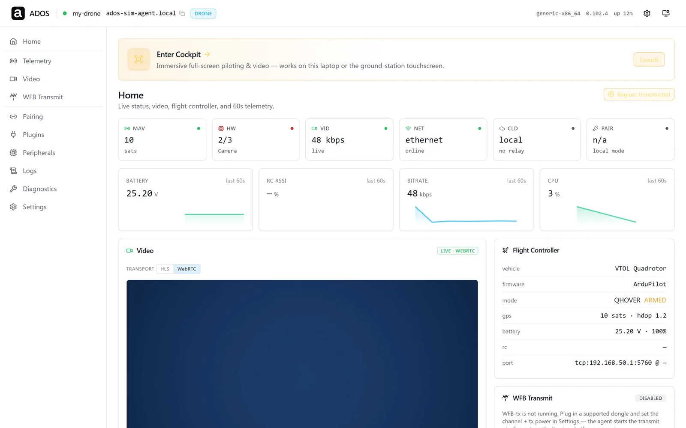
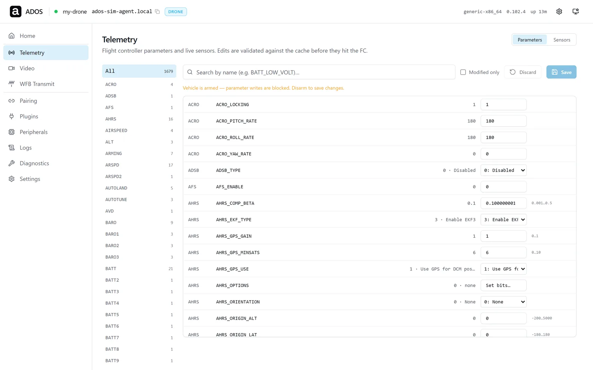
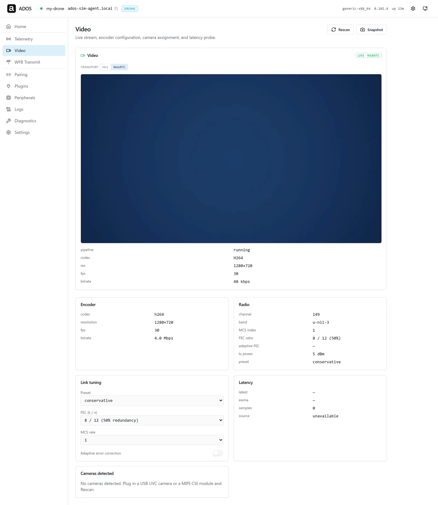
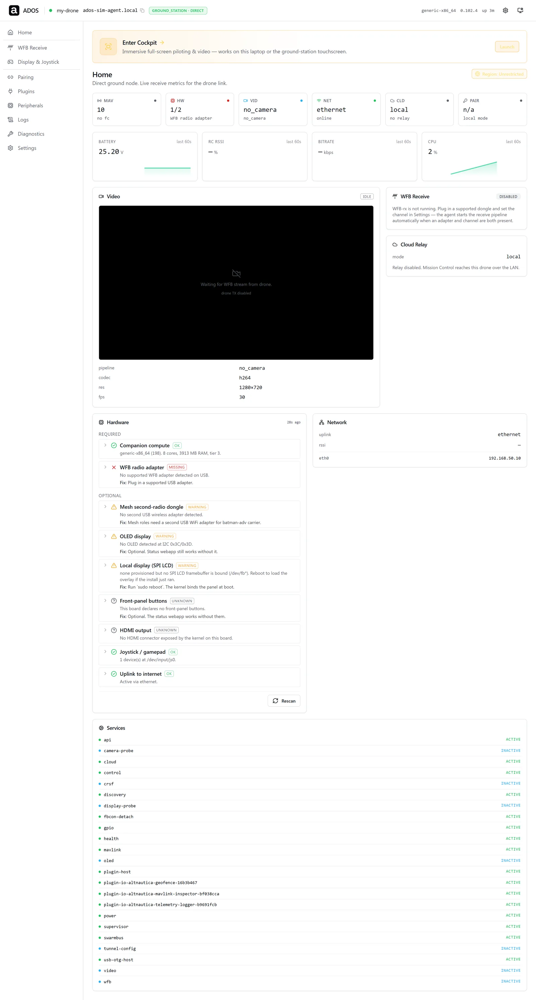
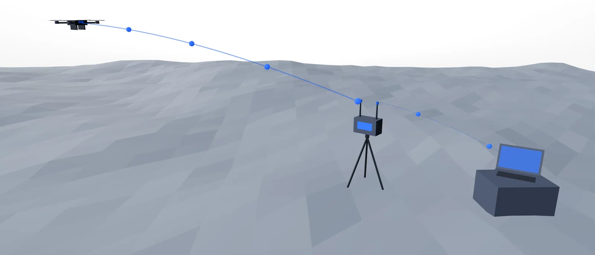
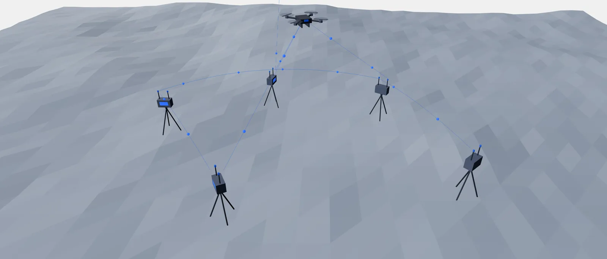
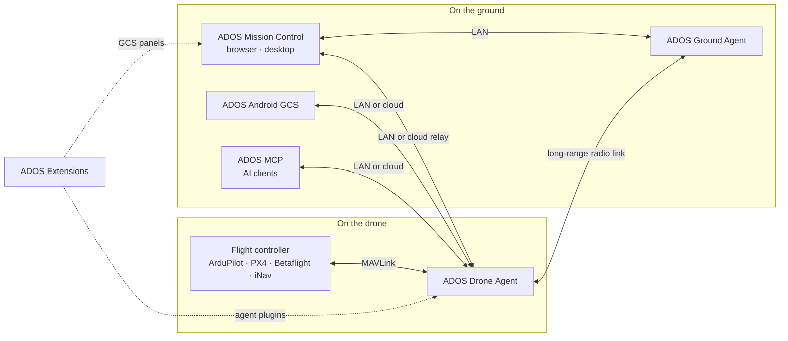

<p align="center">
  <a href="https://altnautica.com">
    <picture>
      <source media="(prefers-color-scheme: dark)" srcset=".github/assets/brand/ados-lockup-dark.svg">
      
    </picture>
  </a>
</p>
<h1 align="center">ADOS Drone Agent</h1>
<p align="center"><em>Open-source onboard agent for software-defined drones. Long-range data link. HD video. Full remote control.</em></p>
<p align="center">   <a href="https://discord.gg/uxbvuD4d5q"></a></p>
<p align="center">
  <strong><a href="https://github.com/altnautica/ADOSMissionControl">Mission Control</a></strong> |
  <strong><a href="https://github.com/altnautica/ADOSDroneAgent">Drone Agent</a></strong> |
  <strong><a href="https://github.com/altnautica/ADOSAndroidGCS">Android GCS</a></strong> |
  <strong><a href="https://github.com/altnautica/ADOSExtensions">Extensions</a></strong> |
  <strong><a href="https://github.com/altnautica/ADOS-MCP">MCP</a></strong> |
  <strong><a href="https://github.com/altnautica/ADOSDroneAgent/tree/main/crates#published-crates">Rust crates</a></strong> |
  <strong><a href="https://docs.altnautica.com">Docs</a></strong> |
  <strong><a href="https://altnautica.com">Website</a></strong> |
  <strong><a href="https://discord.gg/uxbvuD4d5q">Discord</a></strong>
</p>

<p align="center"><a href="#quick-start">Install</a> · <a href="https://docs.altnautica.com/drone-agent/overview">Docs</a> · <a href="https://github.com/altnautica/ADOSDroneAgent/issues">Issues</a></p>

https://github.com/user-attachments/assets/09f265f4-b692-468a-a170-2be2d8525ae7

<p align="center">
  <picture>
      <source media="(prefers-color-scheme: dark)" srcset=".github/assets/scenes/drone-brain-dark.webp">
      
    </picture>
</p>

ADOS Drone Agent is the onboard software for a software-defined drone. It runs on the companion computer next to your flight controller, reads MAVLink off the FC and routes it to any ground station, streams HD video over radio or the internet, and lets you fly and manage the aircraft from a browser. The flight-critical paths are native Rust. AI, vision, and plugins run in Python.

## Quick Start

Deploy to a companion computer (Raspberry Pi, Radxa, Jetson, and similar ARM64 Linux boards):

```bash
curl -sSL https://raw.githubusercontent.com/altnautica/ADOSDroneAgent/main/scripts/install.sh | sudo bash
```

Root is required. The one-line bootstrap fetches and verifies a prebuilt Rust installer, which places the native Rust service binaries, provisions a Python virtualenv for the feature services, configures the systemd units, and starts the setup webapp on the device.

After install, SSH into the node and run:

```bash
ados
```

The terminal status page shows the local setup URL, LAN or hotspot URLs, MAVLink state, video state, services, and remote-access state.

### System Requirements

| Requirement | Minimum | Recommended |
|-------------|---------|-------------|
| OS | Linux with systemd (ARM64 or x86_64) | Raspberry Pi OS, Debian, Ubuntu, Armbian |
| RAM | 1 GB | 2 GB+ |
| Storage | 500 MB | 2 GB+ |
| Python | 3.11+ | 3.12 |
| FC connection | Serial (UART or USB) | UART at 921600 baud |

Also runs on macOS for local development (the installer points you to `cargo` there). Boards with less than 1 GB of RAM are not supported by the standard profile.

---

## Features

<table>
  <tr>
    <td width="50%">
      <picture>
        <source media="(prefers-color-scheme: dark)" srcset=".github/assets/screens/drone-home-dark.webp">
        
      </picture><br>
      <sub>Home: services, link state and system resources. <a href="https://docs.altnautica.com/drone-agent/dashboard-home">Docs</a></sub>
    </td>
    <td width="50%">
      <picture>
        <source media="(prefers-color-scheme: dark)" srcset=".github/assets/screens/drone-telemetry-dark.webp">
        
      </picture><br>
      <sub>Live flight controller telemetry. <a href="https://docs.altnautica.com/drone-agent/dashboard-telemetry">Docs</a></sub>
    </td>
  </tr>
  <tr>
    <td width="50%">
      <picture>
        <source media="(prefers-color-scheme: dark)" srcset=".github/assets/screens/drone-video-dark.webp">
        
      </picture><br>
      <sub>HD video pipeline status and preview. <a href="https://docs.altnautica.com/drone-agent/dashboard-video">Docs</a></sub>
    </td>
    <td width="50%">
      <picture>
        <source media="(prefers-color-scheme: dark)" srcset=".github/assets/screens/drone-plugins-catalog-dark.webp">
        
      </picture><br>
      <sub>Install signed plugins from the catalog. <a href="https://docs.altnautica.com/drone-agent/dashboard-extensions">Docs</a></sub>
    </td>
  </tr>
  <tr>
    <td width="50%">
      <picture>
        <source media="(prefers-color-scheme: dark)" srcset=".github/assets/screens/ground-home-dark.webp">
        
      </picture><br>
      <sub>The same agent running as a ground node. <a href="https://docs.altnautica.com/ground-agent/dashboard-overview">Docs</a></sub>
    </td>
    <td width="50%">
      <picture>
        <source media="(prefers-color-scheme: dark)" srcset=".github/assets/scenes/video-link-dark.webp">
        
      </picture><br>
      <sub>Long-range WFB-ng video and telemetry link. <a href="https://docs.altnautica.com/drone-agent/wfb-ng">Docs</a></sub>
    </td>
  </tr>
  <tr>
    <td width="50%">
      <picture>
        <source media="(prefers-color-scheme: dark)" srcset=".github/assets/scenes/mesh-dark.webp">
        
      </picture><br>
      <sub>Two or three ground nodes form a receive mesh. <a href="https://docs.altnautica.com/ground-agent/mesh-overview">Docs</a></sub>
    </td>
    <td width="50%"></td>
  </tr>
</table>

## What it lets you do

- **Turn a companion computer into a connected drone with one command.** A single installer flashes nothing, builds nothing on the device, and leaves a paired, video-streaming, telemetry-flowing aircraft.
- **Pair over your own network, no cloud account.** The agent auto-pairs with Mission Control over the LAN. Cloud relay is there when you want to reach the drone from anywhere, and off by default.
- **Fly the FC from a browser.** Arm, change modes, fly guided, and upload missions. The agent routes MAVLink to WebSocket, TCP, and UDP at the same time, so several ground stations can connect at once.
- **Watch HD video over radio or the internet.** The video pipeline drives RTSP, WebRTC (WHEP), and a long-range WFB-ng radio link, and plays back in the browser.
- **Reach the drone from anywhere.** Optional cloud relay carries telemetry and commands over the internet with no port forwarding.
- **Sign your MAVLink.** Transparent pass-through for MAVLink v2 signing, with one-shot flight-controller enrollment. Key material stays in the ground station, never on the agent.
- **Run the same agent on the ground.** A ground-station profile (no flight controller, an OLED and buttons, a WFB-ng adapter) turns a small board into the receiving end of the radio link.
- **Build distributed receive.** Two or three ground nodes form a self-healing mesh so you keep the link in obstructed areas.
- **Extend it without forking it.** Install signed plugins that add drivers, behaviors, AI models, and ground-station hardware support.

---

## How ADOS fits together



ADOS Ground Agent is the Drone Agent running its ground-station profile.

<!-- ados-family:repos -->
| Repo | Runs on | What it does | Link |
|---|---|---|---|
| ADOS Mission Control | Browser, desktop (Electron) | Ground control station: FC setup, mission planning, flight, 3D simulation, fleet | [ADOSMissionControl](https://github.com/altnautica/ADOSMissionControl) |
| ADOS Drone Agent | Companion computer on the drone, or a ground node | Onboard agent: MAVLink routing, HD video, long-range radio link, plugins, remote control | [ADOSDroneAgent](https://github.com/altnautica/ADOSDroneAgent) |
| ADOS Android GCS | Android phones and tablets | Native ground control app for agents on the LAN, direct flight controllers and the cloud | [ADOSAndroidGCS](https://github.com/altnautica/ADOSAndroidGCS) |
| ADOS Extensions | Drone Agent and Mission Control | First-party signed plugins, each with an agent half and a GCS half | [ADOSExtensions](https://github.com/altnautica/ADOSExtensions) |
| ADOS MCP | Your machine | Model Context Protocol server that lets AI clients operate ADOS drones under scopes and a safety gate | [ADOS-MCP](https://github.com/altnautica/ADOS-MCP) |
| Documentation | docs.altnautica.com | Public docs for every ADOS product | [Documentation](https://github.com/altnautica/Documentation) |
<!-- /ados-family:repos -->

---

## Why Rust

The flight-critical paths are native Rust: the process supervisor that drives systemd, the MAVLink router, the video pipeline, the WFB-ng radio control, the on-device vision host, and the HTTP control surface on `:8080`. That choice buys three things you can feel:

- **Predictable, low-overhead control and telemetry.** No garbage-collector pauses on the path between the flight controller and the ground.
- **A small memory and CPU footprint.** The native services idle in tens of megabytes, which leaves headroom for video encode and vision on modest boards.
- **A path to a zero-Python headless profile.** On the smallest boards the agent can run the Rust core alone (MAVLink, camera, radio, control), which drops the Python interpreter and most of the memory floor with it.

Python stays where it earns its place: AI and vision inference, the Python plugin runner, hardware bring-up, and the setup webapp. A few mature C programs are supervised rather than rewritten (the RTL8812EU driver, `wfb_tx` and `wfb_rx`, `ffmpeg`, and `mediamtx`). systemd remains the process manager; the Rust supervisor orchestrates the units, it does not replace systemd.

---

## Architecture at a glance

The agent sits between the flight controller and every ground client; the diagram in [How ADOS fits together](#how-ados-fits-together) shows where it lives in the system. On the device itself:

- **`ados-control`**, a native Rust HTTP front, owns port `:8080`. It serves the control, telemetry, pairing, parameter, fleet, plugin, video and ground-station routes natively, and reverse-proxies a small Python feature service on an internal socket for AI and vision inference, the setup webapp and peripherals.
- **Rust core services** (systemd units): supervisor, MAVLink router, video, cloud relay, WFB-ng radio, vision host, plugin host, and ground-station receive and uplink.
- **Supervised C programs**: the RTL8812EU driver, `wfb_tx` and `wfb_rx`, `ffmpeg` and `mediamtx`.
- **Python feature service**: AI and vision inference, the Python plugin runner, HAL bootstrap and the setup webapp.

On a device the agent installs as a set of systemd services plus a Python virtualenv, both placed by the prebuilt Rust installer. Routes read FC status, telemetry, video, radio, and parameter state through named accessors, so the control surface stays independent of service internals.

---

## Supported hardware

The agent auto-detects the board on boot and scales features to the resources it finds. 22 board profiles ship in [`src/ados/hal/boards/`](src/ados/hal/boards/); any ARM64 or x86_64 Linux board with a serial port and systemd should work through a generic profile.

| Board | SoC | Profile file |
|---|---|---|
| BeagleBoard.org BeagleY-AI | TI AM67A (J722S) | `beagley-ai.yaml` |
| Raspberry Pi Compute Module 3 | BCM2837 | `cm3.yaml` |
| Raspberry Pi CM4 | BCM2711 | `cm4.yaml` |
| Raspberry Pi CM5 | BCM2712 | `cm5.yaml` |
| Radxa Cubie A7S | Allwinner A733 | `cubie-a7s.yaml` |
| Radxa Cubie A7Z | Allwinner A733 | `cubie-a7z.yaml` |
| generic-arm64 | Any | `generic-arm64.yaml` |
| generic-x86_64 | Any | `generic-x86_64.yaml` |
| NVIDIA Jetson Nano | Tegra X1 | `jetson-nano.yaml` |
| NVIDIA Jetson Orin Nano | Tegra Orin | `jetson-orin-nano.yaml` |
| Orange Pi 5 | RK3588S | `orange-pi-5.yaml` |
| D-Robotics RDK X3 | Horizon Sunrise X3 | `rdk-x3.yaml` |
| Radxa CM3 (RK3566) | RK3566 | `rk3566.yaml` |
| Rockchip RK3576 (Reference) | RK3576 | `rk3576.yaml` |
| Radxa CM4 (RK3588S2) | RK3588S2 | `rk3588s2.yaml` |
| Radxa ROCK 5B+ (RK3588) | RK3588 | `rock-5b-plus.yaml` |
| Radxa ROCK 5C Lite (RK3582) | RK3582 | `rock-5c-lite.yaml` |
| Raspberry Pi 3 | BCM2837 | `rpi3.yaml` |
| Raspberry Pi 4B | BCM2711 | `rpi4b.yaml` |
| Raspberry Pi 5 | BCM2712 | `rpi5.yaml` |
| Rockchip RV1126B | RV1126B | `rv1126b.yaml` |
| Raspberry Pi Zero 2 W | BCM2710A1 | `zero2w.yaml` |

The same codebase also runs the ground-station profile (no flight controller, an OLED or SPI LCD with buttons, and a WFB-ng adapter); a hardware fingerprint at boot picks the profile.

**Mesh role hardware.** A single ground node (`direct` role) needs one RTL8812EU USB WiFi adapter for WFB-ng. Relay and receiver nodes add a second USB WiFi dongle that carries the batman-adv mesh traffic between nodes. Any adapter with a Linux driver that supports 802.11s or IBSS mode works for the mesh carrier.

---

## Rust crates

The reusable libraries under `crates/` are published on crates.io under `MIT OR Apache-2.0` (`ados-sensorhub` is MIT). The full index, with versioning rules, is [crates/README.md](crates/README.md).

<!-- ados-family:crates -->
**Platform (versioned with the ADOS Drone Agent)**

| Crate | What it does | Docs |
|---|---|---|
| [`ados-protocol`](https://crates.io/crates/ados-protocol) | Wire contracts of the ADOS Drone Agent: IPC framing, plugin RPC envelope, capability tokens and the vision frame bus. | [docs.rs](https://docs.rs/ados-protocol) |
| [`ados-sdk`](https://crates.io/crates/ados-sdk) | Write Rust plugins for the ADOS Drone Agent: IPC client, plugin context, driver traits and lifecycle runner. | [docs.rs](https://docs.rs/ados-sdk) |
| [`ados-vision`](https://crates.io/crates/ados-vision) | Single-object visual tracker: Kalman motion model, appearance re-identification and YOLOv8 head decoding. | [docs.rs](https://docs.rs/ados-vision) |
| [`ados-gpio`](https://crates.io/crates/ados-gpio) | Drive status buzzers and LEDs on Linux GPIO lines, with bounded software-PWM beep patterns. | [docs.rs](https://docs.rs/ados-gpio) |
| [`ados-hal-probe`](https://crates.io/crates/ados-hal-probe) | Find out what a board's hardware can really do by probing it, plus bundled board profiles. | [docs.rs](https://docs.rs/ados-hal-probe) |

**Standalone**

| Crate | What it does | Docs |
|---|---|---|
| [`ados-sensorhub`](https://crates.io/crates/ados-sensorhub) | Sensor hub wire protocol: COBS framing, CRC-16 and fixed-layout IMU, baro, mag and GNSS packets. no_std. | [docs.rs](https://docs.rs/ados-sensorhub) |
| [`ados-offload`](https://crates.io/crates/ados-offload) | Choose where perception runs (onboard, offloaded or hybrid) and hold the vehicle when results go stale. | [docs.rs](https://docs.rs/ados-offload) |
| [`ados-macpin`](https://crates.io/crates/ados-macpin) | Stable MAC addresses for Linux network adapters that randomize theirs every boot. | [docs.rs](https://docs.rs/ados-macpin) |
| [`ados-lora`](https://crates.io/crates/ados-lora) | LoRa transmit governor with cited regional band plans, duty cycle, dwell time and airtime accounting. | [docs.rs](https://docs.rs/ados-lora) |
| [`ados-crsf-codec`](https://crates.io/crates/ados-crsf-codec) | no_std CRSF / ExpressLRS codec for RC channels, telemetry and parameter frames. | [docs.rs](https://docs.rs/ados-crsf-codec) |
| [`ados-positioning`](https://crates.io/crates/ados-positioning) | Split mixed UBX, NMEA and RTCM3 GNSS streams, configure u-blox receivers and run an RTK base survey-in. | [docs.rs](https://docs.rs/ados-positioning) |
| [`ados-rtcm`](https://crates.io/crates/ados-rtcm) | RTCM3 framing, CRC-24Q and MAVLink GPS_RTCM_DATA fragmentation for RTK corrections. | [docs.rs](https://docs.rs/ados-rtcm) |
| [`ados-clock`](https://crates.io/crates/ados-clock) | Map remote clocks onto the host clock: least-squares and envelope fits, TIMESYNC and a chrony sink. | [docs.rs](https://docs.rs/ados-clock) |
| [`ados-swarm`](https://crates.io/crates/ados-swarm) | Swarm control laws: separation, flocking, formations, CBBA task allocation and a point-mass simulator. | [docs.rs](https://docs.rs/ados-swarm) |
| [`ados-mavlink-tunnel`](https://crates.io/crates/ados-mavlink-tunnel) | Send large messages over MAVLink TUNNEL frames with chunking and bounded reassembly. | [docs.rs](https://docs.rs/ados-mavlink-tunnel) |
| [`ados-display-driver`](https://crates.io/crates/ados-display-driver) | Small-display output on Linux: SSD1306/SH1106 OLED over I2C, pixel packers and a framebuffer writer. | [docs.rs](https://docs.rs/ados-display-driver) |
| [`ados-hmi`](https://crates.io/crates/ados-hmi) | Front-panel input: touchscreen calibration and gestures, button presses and rotary encoders. | [docs.rs](https://docs.rs/ados-hmi) |
<!-- /ados-family:crates -->

---

## CLI Reference

The public everyday CLI is intentionally small. Run `ados --help` for the current command list.

| Command | Description |
|---------|-------------|
| `ados` | Open the read-only terminal status page, or plain status when not attached to a TTY |
| `ados status` | Print setup, MAVLink, video, network, remote-access, and service status |
| `ados status --json` | Print the full setup facade payload for scripts |
| `ados update` | Update the agent to the latest version (re-runs the installer upgrade) |
| `ados update --check-only` | Report the current and latest version without installing |
| `ados uninstall` | Remove the agent from the system |
| `ados uninstall --purge --yes` | Remove services, package files, and config without prompts |

Grouped subcommands cover the deeper surfaces: `ados plugin` (install and manage plugins), `ados logs` (query the on-device black-box log store), `ados network`, `ados radio`, and `ados profile`. Use the setup webapp or the Mission Control node panel for configuration, ground-station pairing, video, network, and remote access.

---

## REST API

Served by the native Rust front (`ados-control`) on `:8080`. Control, telemetry, plugin and WHEP video routes are native; AI/vision, setup, and peripheral routes are proxied to the Python feature service. Full reference at [docs.altnautica.com](https://docs.altnautica.com).

| Endpoint | Method | Description |
|----------|--------|-------------|
| `/api/v1/setup/status` | GET | Universal setup, access URL, MAVLink, video, network, and remote-access status |
| `/api/v1/setup/remote-access/cloudflare` | POST | Install a Cloudflare Tunnel token or install command |
| `/api/status` | GET | Agent status, uptime, FC state |
| `/api/telemetry` | GET | Attitude, GPS, battery snapshot |
| `/api/params` | GET | Read cached FC parameters |
| `/api/command` | POST | Send a MAVLink command to the FC |
| `/api/commands` | GET | List supported command names |
| `/api/config` | GET / PUT | Read or update agent config |
| `/api/services` | GET | Running services and status |
| `/api/video` | GET / POST | Video pipeline status and control |
| `/api/plugins` | GET / POST / DELETE | Plugin install, list, enable, disable, remove, info |
| `/api/fleet/*` | GET | Fleet enrollment and peer status |
| `/api/peripherals` | GET | Connected sensors and hardware |
| `/api/pairing/*` | GET / POST | GCS pairing management |
| `/api/mavlink/signing/*` | GET / POST | Signing capability detection and one-shot FC enrollment |
| `/api/system` | GET / POST | System info, reboot, shutdown |
| `/api/v1/ground-station/*` | GET / PUT / POST / DELETE | Ground-station profile only. Role, mesh, pairing, WFB-ng relay/receiver, uplinks, physical UI |

```bash
# Get current telemetry
curl http://localhost:8080/api/telemetry

# Arm the drone
curl -X POST http://localhost:8080/api/command \
  -H "Content-Type: application/json" \
  -d '{"command": "arm"}'
```

---

## Connectivity

ADOS is local-first. The primary path between Mission Control and the agent is your own network.

**Local pairing (default).** Mission Control reaches the agent over the LAN by hostname or IP. The apiKey is stored in the browser, with no cloud round-trip. An agent with cloud relay disabled is in its normal, correct state.

**Long-range radio link.** The drone-to-ground data link is WFB-ng on 5.8 GHz, with forward error correction, for video and telemetry without any internet. It auto-binds to the ground station on first boot.

**Cloud relay (optional).** For remote access across networks, the agent connects to Mission Control over a relay:

- **Convex HTTP (baseline).** Every 5 seconds the agent posts full status to the cloud, and the ground station reads it through reactive queries. Commands go the other way. No extra infrastructure.
- **MQTT telemetry (real-time).** When `server.mode` is `cloud` or `self_hosted`, the agent publishes to `ados/{deviceId}/status` and `ados/{deviceId}/telemetry` over a Mosquitto WebSocket. The browser subscribes directly. 2 Hz and faster.
- **RTSP video.** The video pipeline pushes to a cloud relay that converts it to fMP4 over WebSocket for browser playback at 0.5 to 1.5 s latency.

| Config field | Default | Description |
|---|---|---|
| `server.mode` | `disabled` | `disabled`, `cloud`, or `self_hosted` |
| `server.mqtt_transport` | `tcp` | `tcp` or `websockets` |
| `server.mqtt_username` | - | MQTT broker username |
| `video.cloud_relay_url` | - | RTSP relay server URL |

---

## Directory Structure

| Path | Contents |
|------|----------|
| `crates/` | Native Rust services (one crate per service) plus the shared protocol and SDK crates |
| `src/ados/` | Python runtime: feature service, HAL detection, plugins, SDK, ground-station managers |
| `data/` | systemd units, udev rules, overlays, and other deploy-time assets |
| `scripts/` | Installer bootstrap and helper scripts |
| `dashboard/` | Local web dashboard assets |
| `docs/` | Deployment, ground-station, and OEM documentation |
| `tests/` | Test suite |

---

## What's Working

| Feature | Status |
|---------|--------|
| Native Rust HTTP front (`ados-control` on `:8080`) | Working |
| Rust process supervisor (systemd orchestration) | Working |
| MAVLink router (serial to WS/TCP/UDP) | Working |
| Prebuilt Rust installer (fetch, verify, provision, configure) | Working |
| Minimal public CLI | Working |
| Demo mode (simulated telemetry) | Working |
| Hardware auto-detection (board profiles) | Working |
| Config system (Pydantic + YAML) | Working |
| Health monitoring (CPU, RAM, disk, temp) | Working |
| On-device black-box log store (`ados logs`) | Working |
| Cloud relay (Convex HTTP + MQTT) | Working |
| GCS pairing (local-first over LAN, cloud relay optional) | Working |
| MAVLink v2 signing pass-through | Working |
| Agent updates (`ados update`) | Working |
| Video pipeline (RTSP, WebRTC/WHEP, WFB-ng) | Working |
| WFB-ng long-range link (5.8 GHz, FEC, auto-bind) | Working |
| On-device vision host (frame bus, detectors) | Working |
| Plugin system (Python and Rust plugins) | Working |
| Ground-station distributed receive and local mesh | Working |
| Lean headless profile (Rust core only) | In progress |
| Swarm formation flight | Planned |

---

## Development

The Python runtime:

```bash
git clone https://github.com/altnautica/ADOSDroneAgent.git
cd ADOSDroneAgent
python -m venv .venv && source .venv/bin/activate
pip install -e ".[dev]"

pytest          # run tests
ruff check src/ # lint
ados --help     # inspect the public CLI
```

The native services live under `crates/` (a Cargo workspace):

```bash
cargo build     # build the Rust service crates
cargo test
```

On a device the installer fetches prebuilt Rust binaries, so deploying needs no Rust toolchain. You only need one to build the services from source.

See [AGENTS.md](AGENTS.md) for architecture notes and [CONTRIBUTING.md](CONTRIBUTING.md) for code style and PR guidelines.

---

## Community

- **[Discord](https://discord.gg/uxbvuD4d5q)** - Ask questions, share builds
- **[LinkedIn](https://www.linkedin.com/company/altnautica/)** - Follow company updates
- **[Email](mailto:team@altnautica.com)** - team@altnautica.com
- **[Issues](https://github.com/altnautica/ADOSDroneAgent/issues)** - Bug reports and discussions
- **[Website](https://altnautica.com)** - Company and product info

---

## Contributing

See [CONTRIBUTING.md](CONTRIBUTING.md) for code style and PR guidelines, and [AGENTS.md](AGENTS.md) for architecture notes.

---

## License

[GPL-3.0-or-later](LICENSE). Free to use, modify, and distribute. Derivative works must also be GPL-3.0-or-later. Library crates under `crates/` listed in [crates/README.md](crates/README.md) are MIT OR Apache-2.0.
